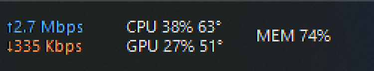
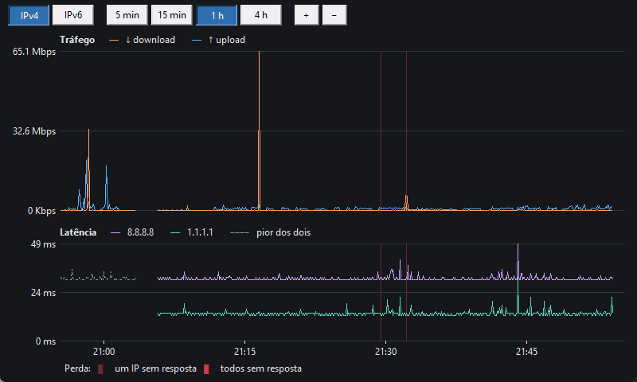

Atualizado em 2026-11-13 (histórico em dois painéis; limites de temperatura e cores em 2026-10-25)

# Telas

Editor Tk real capturado em 2026-10-25: quinze campos, defaults de uso 50/75/90 e temperatura 60/75/85 °C; caixas clicáveis de cores globais, ajuda das faixas 0–100/0–120, Restaurar cores padrão e Salvar/Cancelar. Captura de 376 × 426 px somente da área cliente, pelo retângulo winfo_rootx/rooty/width/height e PowerShell/System.Drawing.CopyFromScreen, sem Pillow. Raiz própria oculta e config.ini temporário (inalterado); editor/raiz destruídos e processo de captura finalizado. Imagem conferida visualmente, sem cortes. Não é captura do widget em uso nem validação das cores no Explorer.

Os modos `docked` (faixa acima da barra) e `floating` (caixa arrastável) não foram capturados.

Janela do histórico (1 h, IPv4) capturada em 2026-11-13 em Tk real, 800x480, com cópia do histórico do Mateus (arquivo original intocado): painel de tráfego com ↓/↑, painel de latência com 8.8.8.8 (lilás), 1.1.1.1 (verde-água) e `pior dos dois` tracejado cinza, marcas de perda cruzando os dois painéis e legenda de perda sob os horários. Captura por winfo_root + CopyFromScreen com DPI aware; processos encerrados.
