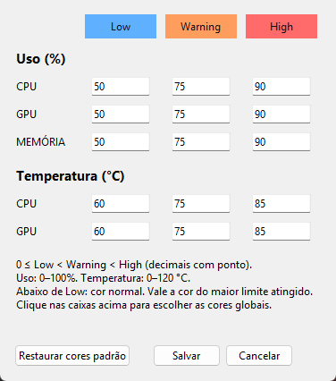
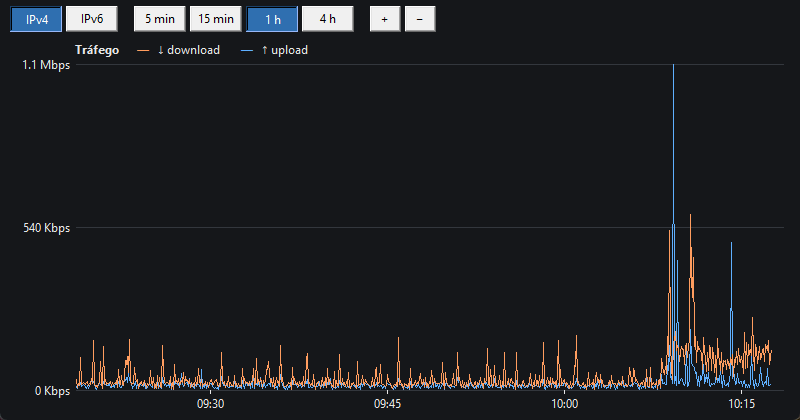
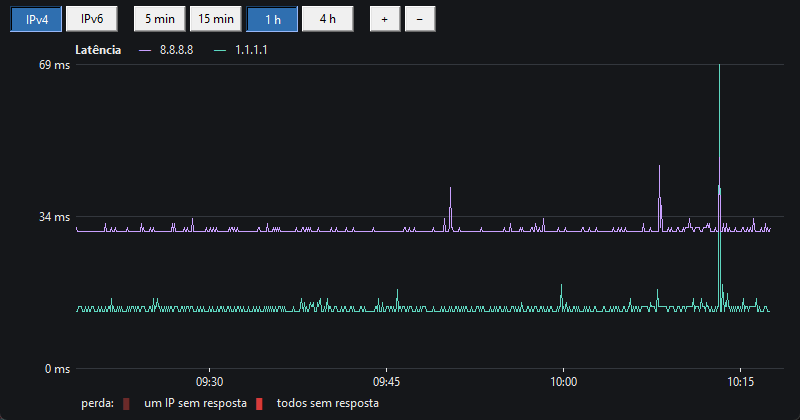
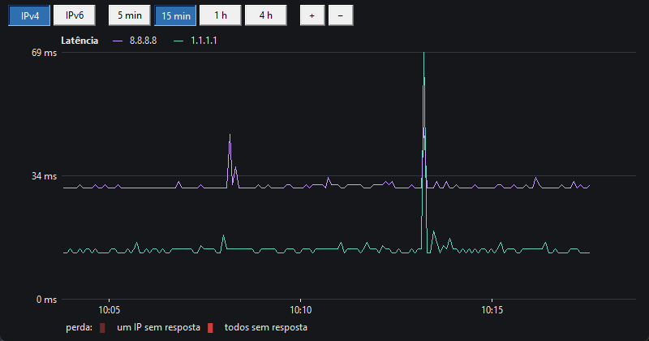
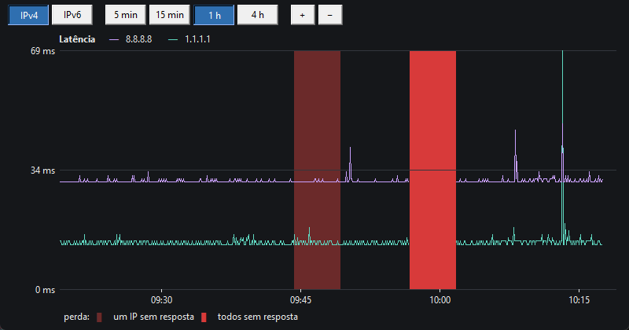
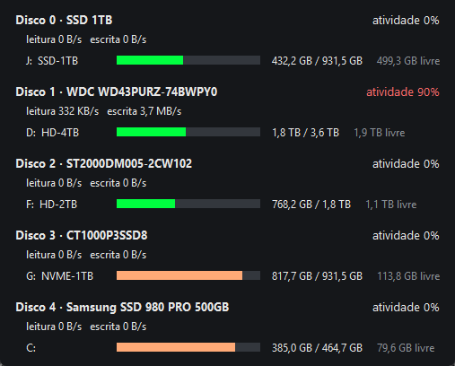

Atualizado em 2026-11-16 (1.2.0 local: discos)

# Telas

Editor Tk real capturado em 2026-10-25: quinze campos, defaults de uso 50/75/90 e temperatura 60/75/85 °C; caixas clicáveis de cores globais, ajuda das faixas 0–100/0–120, Restaurar cores padrão e Salvar/Cancelar. Captura de 376 × 426 px somente da área cliente, pelo retângulo winfo_rootx/rooty/width/height e PowerShell/System.Drawing.CopyFromScreen, sem Pillow. Raiz própria oculta e config.ini temporário (inalterado); editor/raiz destruídos e processo de captura finalizado. Imagem conferida visualmente, sem cortes. Não é captura do widget em uso nem validação das cores no Explorer.

Os modos `docked` (faixa acima da barra) e `floating` (caixa arrastável) não foram capturados.

As duas janelas do histórico (desde 2026-11-14; antes era uma só, em dois painéis) foram capturadas em 2026-11-14 em Tk real, 800x420, com cópia do histórico do Mateus (original intocado): `SysMonitor · Tráfego (estimado)` com ↓/↑ e `SysMonitor · Latência e perda` com 8.8.8.8 (lilás), 1.1.1.1 (verde-água) e legenda de perda. A quarta imagem usa uma cópia do histórico com marcas de perda injetadas só para ver as faixas (o histórico real do trecho não tinha perda). Captura por winfo_root + CopyFromScreen com DPI aware; processos encerrados.

Janela Discos (1.2.0, local) capturada em 2026-11-16 em Tk real isolado (raiz oculta, `DiskMonitor` real com dois ciclos), 507 × 408 px, só a área cliente, mesmo método de CopyFromScreen com DPI aware. Discos 0 a 4 (J, D, F, G, C) com modelo, atividade, leitura/escrita e barra de espaço proporcional; sem texto cortado. Não é captura do widget com a coluna de disco na barra.
